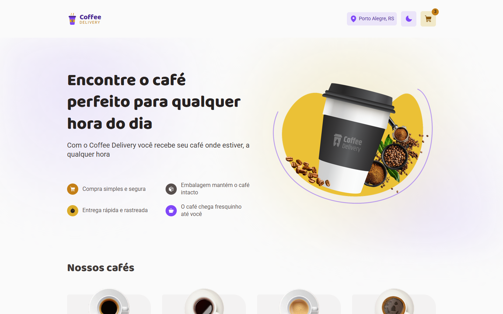
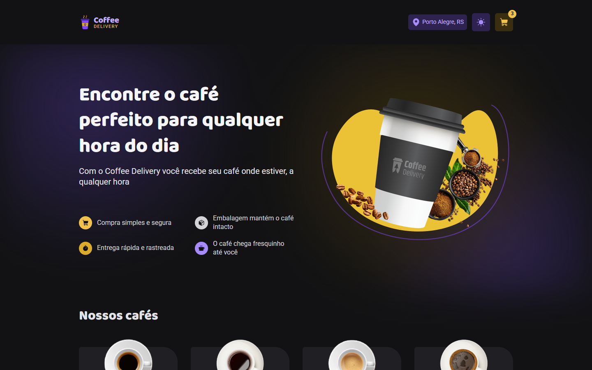
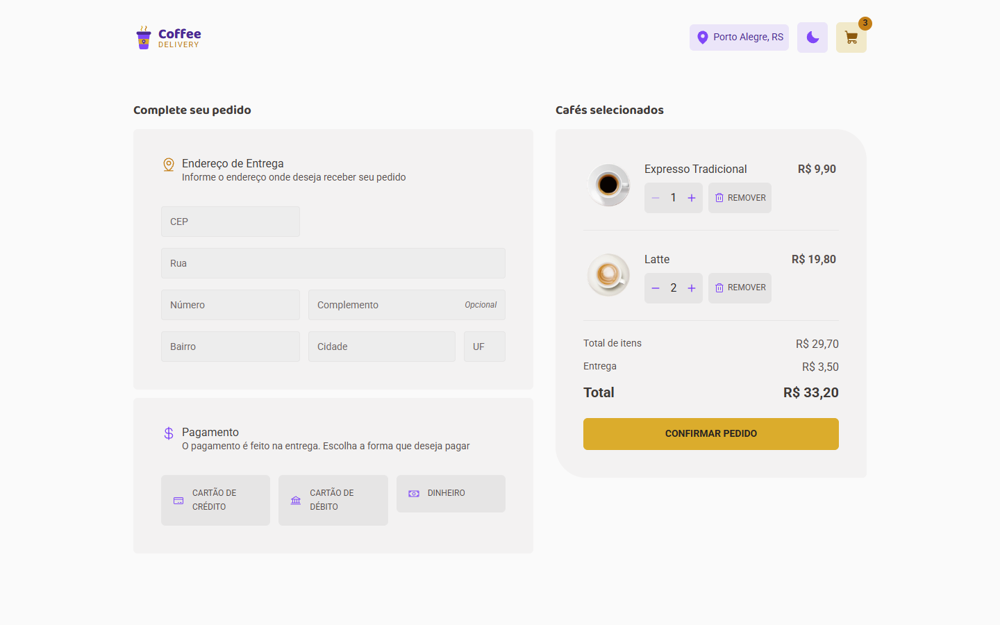
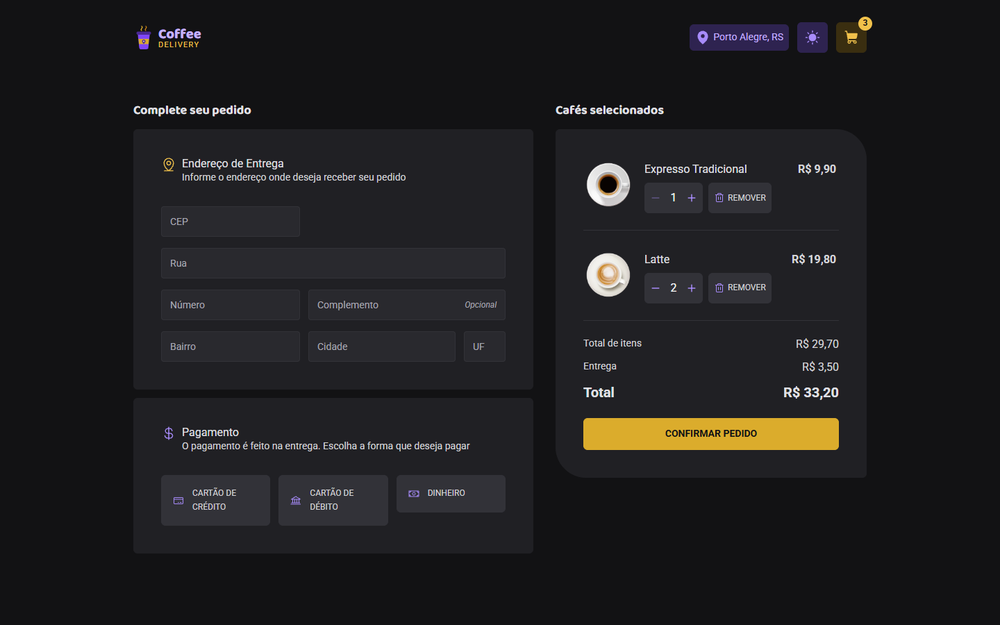
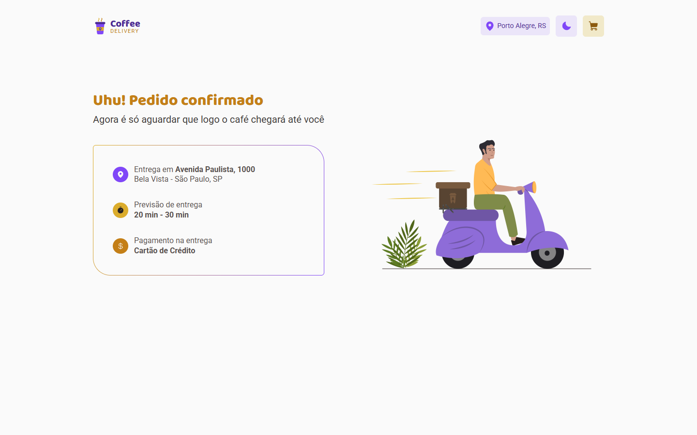
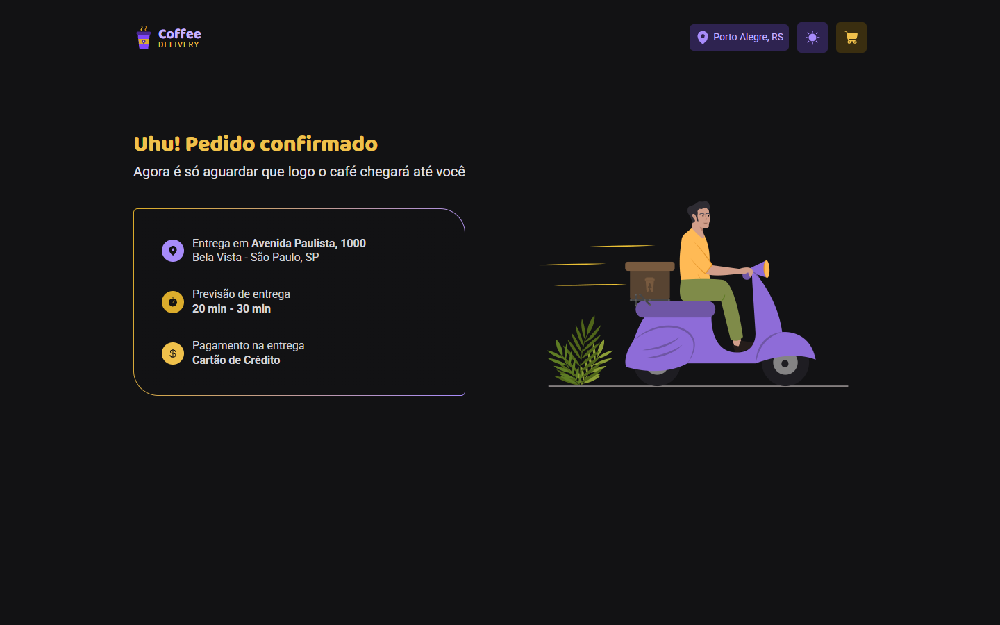

# Coffee Delivery

Cafeteria em **Single Page Application**: catálogo de cafés, carrinho, checkout com endereço preenchido pelo CEP e confirmação de um pedido fictício. Projeto Final 05 da disciplina *Single Page Application* (Senac), feito em React + TypeScript com apoio de IA documentado.

- **Aplicação publicada:** https://coffee-delivery-chi-bay.vercel.app/
- **Figma:** [Coffee Delivery • Projeto Final React](https://www.figma.com/design/yGPNTA0Yczb183EikXGIiA/Coffee-Delivery-%E2%80%A2-Projeto-Final-React?node-id=2-1297)



## Funcionalidades

- Catálogo com 14 cafés, tags, preço e seletor de quantidade (mínimo 1).
- Carrinho global (Context API + `useReducer`) com contador no Header, persistido no `localStorage`.
- Checkout: alterar quantidade, remover item, subtotal + taxa fixa de entrega (R$ 3,50) + total, todos **derivados** (nunca guardados em estado).
- Endereço com **React Hook Form + Zod**; CEP consulta a **ViaCEP** e preenche rua, bairro, cidade e UF (com estados de carregando, CEP não encontrado e API indisponível; campos continuam editáveis).
- Forma de pagamento (crédito, débito ou dinheiro) com radios reais acessíveis por teclado.
- Confirmação: salva um **snapshot** do pedido, esvazia o carrinho e mostra a tela de sucesso, que continua certa depois do F5.
- Estados vazios: carrinho vazio e `/success` sem pedido.
- Tema **claro/escuro** com persistência e fallback para a preferência do sistema.
- Responsivo de 320 px a 1440 px; acessibilidade WCAG 2.2 AA (skip link, foco gerenciado entre rotas, `aria-live`, contraste verificado).

## Tecnologias e versões

| Item | Versão |
|---|---|
| Node / npm | 22.22.3 / 10.9.8 |
| Vite | 8.3.8 (`@vitejs/plugin-react` 6.3.0) |
| React / React DOM | 19.3.1 |
| TypeScript | 7.0.2 (modo estrito) |
| React Router | 8.5.2 (`react-router`) |
| styled-components | 6.6.0 |
| React Hook Form / Zod / resolvers | 7.92.0 / 4.6.7 / 7.0.8 |
| Ícones | `@phosphor-icons/react` 2.1.10 |
| Testes | Vitest 5.1.1, Testing Library (React 16.3.3, user-event 14.6.13, jest-dom 8.0.0), jsdom 31.0.1 |
| Lint | oxlint 1.94.0 |

## Como rodar

```bash
npm install
npm run dev          # http://localhost:5173
npm run test -- --run
npm run build        # gera dist/
npm run preview      # serve o build
npm run lint
```

Requer Node 20.19+ ou 22.12+ (exigência do Vite 8).

## Arquitetura

```
src/
├── App.tsx                 # só declara as rotas (/, /checkout, /success, *)
├── main.tsx                # AppThemeProvider > BrowserRouter > CartProvider > App
├── components/<Nome>/      # index.tsx + styles.ts (Header, CoffeeCard, CartItem, DeliveryAddressForm...)
├── pages/                  # Home, Checkout, Success
├── contexts/               # CartContext (useReducer) e ThemeContext
├── reducers/               # cartReducer, cartActions, loadInitialCartState
├── hooks/                  # useCart, useTheme, useCepLookup
├── services/viaCep.ts      # único lugar que conhece a URL da ViaCEP
├── schemas/                # checkoutSchema (Zod)
├── utils/                  # formatCurrency, cartCalculations, createOrder, storage
├── data/coffees.ts         # catálogo
├── types/                  # Coffee, CartItem, Order...
├── styles/                 # temas light/dark, tipografia, breakpoints, estilo global
└── tests/                  # 56 testes (unitários e de fluxo)
```

Decisões principais:

- **Estado do carrinho** só pelo `cartReducer` (`ADD_ITEM`, `INCREMENT_ITEM`, `DECREMENT_ITEM`, `REMOVE_ITEM`, `CONFIRM_ORDER`, `CLEAR_CART`). O item guarda apenas `coffeeId + quantity`; nome e preço vêm do catálogo.
- **Dinheiro em centavos** (inteiros); formatação em BRL só na tela.
- **"−" travado em 1** no carrinho; remover só pelo botão "Remover".
- **Pedido como snapshot** (nome, preço, quantidade, endereço, pagamento, totais), salvo em `@coffee-delivery:last-order-1.0.0`.
- Chaves do `localStorage` versionadas: `@coffee-delivery:cart-1.0.0`, `last-order-1.0.0`, `theme-1.0.0`.
- Tokens de cor semânticos por tema; nenhum hex espalhado nos componentes.

Especificações completas: [`docs/PRD_SPEC.md`](docs/PRD_SPEC.md) (o quê), [`docs/TECH_SPEC.md`](docs/TECH_SPEC.md) (como) e [`docs/TASKS_SPEC.md`](docs/TASKS_SPEC.md) (tasks T-00..T-41 com registro de execução).

## Testes

56 testes em 21 arquivos (`npm run test -- --run`):

- **Unitários:** reducer (UT-01..05), cálculos (UT-06), formatação, schema Zod (UT-08), serviço ViaCEP com `fetch` mockado (UT-09), persistência (UT-10), `createOrder`.
- **Fluxo (Testing Library):** contador do Header (IT-01), carrinho vazio (IT-02), validação do endereço (IT-03), **compra completa da Home ao Sucesso com reload** (IT-04), tema persistido (IT-05), autopreenchimento do CEP, pagamento e acessibilidade.

## Telas

| | Claro | Escuro |
|---|---|---|
| Home |  |  |
| Checkout |  |  |
| Sucesso |  |  |

Mobile (390 px): [Home](docs/screenshots/home-mobile.png) · [Checkout](docs/screenshots/checkout-mobile.png) · [Sucesso](docs/screenshots/success-mobile.png) · [Home escuro](docs/screenshots/home-dark-mobile.png)

## Branding

Logo original (copo para viagem com pin de localização) criada com IA em SVG, nas cores do Style Guide. Detalhes, prompt e direitos de uso em [`docs/BRANDING.md`](docs/BRANDING.md).

## Uso de IA

Desenvolvido com **Claude Code** como assistente: análise do enunciado, SPECs, implementação em tasks pequenas, testes, revisão de acessibilidade e contraste. Cada interação relevante está em [`docs/AI_USAGE.md`](docs/AI_USAGE.md), incluindo o que **não** foi decidido pela IA. Context7 MCP e Playwright MCP não estavam disponíveis no ambiente; a conferência de API e a validação visual foram feitas por outros meios, registrados no mesmo arquivo.

## Deploy

Configurado para a **Vercel** (`vercel.json` reescreve todas as rotas para `index.html`, então F5 em `/checkout` e `/success` funciona). Importar o repositório na Vercel com o preset Vite (build `npm run build`, saída `dist`). Publicado em https://coffee-delivery-chi-bay.vercel.app/ a partir da branch `main`.

## Fora do escopo

Backend, autenticação, banco de dados, pagamento real e frete por distância.
